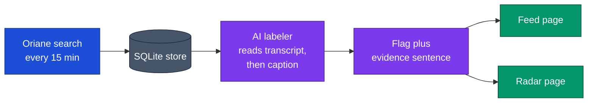
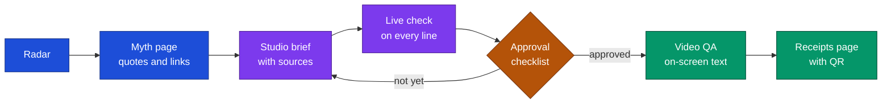

# MyBuster 🕵️

**Spot the health myth. Show the exact words. Ship a sourced debunk.**

MyBuster watches health posts on TikTok, Instagram and YouTube, flags the ones that push claims mainstream evidence does not support, and helps a creator answer them with a video where every line has a source.

## 🔎 What it does

- **Live feed.** Health posts from Oriane, pulled every 15 minutes, newest first.
- **AI labels.** Each post gets a plain verdict. A flagged post shows the exact sentence that is the proof, with a link to the video.
- **Myth radar.** Posts group into myths, and each myth shows whether it is rising or cooling.
- **Calendar and impact pages.** What is coming next week, and whether the response reached as many people as the myth.
- **Studio.** Drafts a debunk from live sources, then re-checks every line as you edit it.
- **Public receipts.** A shareable page with the quote, the verdict, the sources and a QR code.

## 🧭 How the pipeline works



The labeler reads what the creator says first, then the caption. A post is flagged only when a sentence from the post itself shows the claim. The sentence is an exact substring of the text, never a paraphrase.

## 🛠️ From myth to debunk



Nothing is exported until a person works through the checklist. The video QA step compares the words on screen with the approved script.

## 🏷️ How a post is judged

| Verdict | Meaning |
|---|---|
| **Flagged** | Pushes a health claim that mainstream evidence does not support |
| **Makes a claim** | A health claim that is modest or has support |
| **Corrects** | Disputes or corrects a health claim |
| **No claim** | Mentions the topic but claims nothing |
| **Not checked** | Waiting for its turn after a pull |

On a small held-out test set of 30 hand-labeled posts, the flag had precision 6 of 7 and recall 6 of 9. That is a small test. A difference of one or two posts is noise, so read it as a rough guide, not a guarantee. The method and the full numbers are in `docs/research/label-eval-v2.md`.

## 🚀 Quick start

**Brain** (Python 3.11+, [uv](https://docs.astral.sh/uv/)):

```bash
cd services/brain
cp .env.example .env        # then fill in the values
uv run uvicorn app.main:app --reload --port 8000
curl localhost:8000/health
```

**Web** (Node, npm):

```bash
cd apps/web
npm install
npm run dev                 # http://localhost:3000
```

Set `NEXT_PUBLIC_USE_MOCKS=1` to run the web app on fixtures without a brain.

| Where | Env var names (see the `.env.example` files) |
|---|---|
| `services/brain/.env` | `ORIANE_API_KEY`, `ORIANE_SEARCH_URL`, `POLL_INTERVAL_MINUTES`, `ORIANE_MAX_SEARCHES_PER_HOUR`, `OPENAI_BASE_URL`, `OPENAI_API_KEY`, `OPENAI_MODEL`, `GMI_API_KEY`, `GMI_BASE_URL`, `GMI_VLM_MODEL`, `NCBI_EMAIL`, `NCBI_API_KEY`, `ALLOWED_ORIGINS`, `FACT_CHECK_API_TOKEN`, `FACT_CHECK_MODEL`, `REVIEW_TOKEN` |
| `apps/web/.env.local` | `NEXT_PUBLIC_BRAIN_URL`, `NEXT_PUBLIC_USE_MOCKS`, `NEXT_PUBLIC_AMPLITUDE_API_KEY`, `NEXT_PUBLIC_SITE_URL`, `FACT_CHECK_API_TOKEN` |

Never commit real values.

## ☁️ Where it runs

| Part | Host | Deploys |
|---|---|---|
| Web | Vercel | Auto-deploys from `main` |
| Brain | Railway (`railway.json`, health check at `/health`) | Auto-deploys from `main` |

## 🗺️ Repo map

| Path | What |
|---|---|
| `apps/web/` | Next.js app: feed, radar, myth, studio, calendar, impact, receipts |
| `services/brain/` | FastAPI service: poller, labeler, derived views, briefs, live check, video QA |
| `contracts/` | Shared API types and fixtures |
| `data/` | Watchlist, cached data and the hand-labeled eval set |
| `docs/` | Product notes, specs and research |

## 📏 House rules

1. **No source, no claim.** Every claim shown links to an excerpt that is an exact substring of fetched text. With nothing found, the app says "No good source found".
2. **People approve.** AI drafts, a person signs off. Nothing exports or publishes without the checklist.
3. **Plain copy.** Calm, sentence case, no hype, no em dashes. Numbers in the UI come from `docs/research/` with their source.
4. **Name the claim, not the person.** Quote exact words with a link. Never name anyone who looks under 18.
5. **Contracts only grow.** Change `contracts/` through a pull request, with optional fields only.
6. **Mock first.** The web app must keep running on fixtures when the brain is down.
