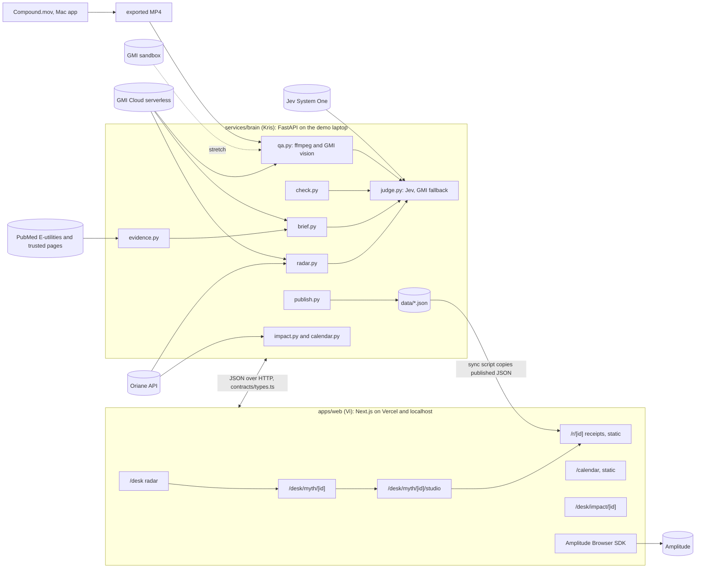

# Architecture

Owner: Kris.

## Diagram

## Where things run
| Piece | Where | Why |
|---|---|---|
| Web desk and studio | localhost:3000 on the demo laptop, also deployed to Vercel in mock mode | Talks to the brain on the same machine, no venue network risk |
| Public pages (`/r/[id]`, `/calendar`) | Vercel, static | Judges scan the QR on their phones; these pages need no brain |
| Brain | localhost:8000 on the demo laptop | Keys stay server-side; caches live in `data/` |
| Oriane, GMI, Jev, PubMed | their clouds | called only by the brain |
| Compound.mov | Vi's Mac | edits and posts the video |
| Amplitude | cloud | the browser SDK sends events; votes live only here |

Vi's laptop is the demo machine and runs both the web app and the brain. At checkpoint 2, Vi pulls `main`, runs `uv sync` and starts the brain with the `.env` Kris sends in a private DM (never in git). Backup: Kris exposes his brain with a quick tunnel (for example `cloudflared tunnel --url http://localhost:8000`) and Vi sets `NEXT_PUBLIC_BRAIN_URL` to that URL.

## Data flow
1. **Radar.** For each myth in `research/MYTH-CATALOG.md`: Oriane counts the topic in the current and previous 30-day windows (`projection: basic`), pulls the top 30 claim videos (`default`), and pulls `full` for the top 5 to get transcript chunks with start seconds. Jev labels stance and the naming flags. A GMI LLM writes the neutral claim sentence. Output: `data/radar.json` and `data/myths/{id}.json`.
2. **Brief.** PubMed E-utilities (`esearch` then `efetch` abstracts) plus seeded trusted pages are fetched and split into numbered sentences. The GMI LLM picks sentence indices, so every excerpt is verbatim by construction. The LLM drafts the brief from those excerpts only. Jev scores support for each claim against its excerpts. Output: `data/briefs/{id}.{format}.json`.
3. **Check.** For each edited line: Jev decides whether it states a health fact, then scores support against every excerpt in the brief and keeps the best.
4. **QA.** ffmpeg pulls 1 frame per second (40 at most). The GMI vision model transcribes on-screen text per frame as JSON. Texts are deduped, matched to approved lines with rapidfuzz, then confirmed with a Jev match question. Unmatched texts that state a claim get a support check.
5. **Publish.** Validates the checklist, keeps only nameable videos, writes `data/published/{id}.json`. Vi's sync script copies it into `apps/web/public/published/` at build time.
6. **Impact and calendar.** Oriane re-pull over the same window; reach of promoting vs debunking videos (from stance labels); clinician baseline; next week's myths from trend plus the curated watchlist.

## Caching
- Every brain endpoint reads from `data/` first. `?refresh=1` (GET) or `refresh: true` (POST /brief) re-runs the pipeline.
- Raw API responses go to `data/cache/` (gitignored). Cache key: sha1 of the request body.
- Committed snapshots in `data/` are the fallback if a sponsor API is down during the demo.

## Failure modes
| Failure | What the user sees | Fallback |
|---|---|---|
| Brain down | Same pages with a small "fixture" badge | Web falls back to `contracts/fixtures` |
| Oriane down or out of credits | Radar from the last snapshot | `data/radar.json` committed at checkpoint 1 |
| Jev down or no key | Same scores, `engine: gmi_judge` | GMI LLM judge with the same question format |
| GMI down | Cached brief, cached QA labeled "cached" | `data/briefs/`, `data/qa/` |
| Vercel build fails | Receipts on localhost | Phone hits the laptop through a tunnel |

## Performance targets
`/radar` and `/myths/{id}` under 300 ms from cache. `/brief` under 45 s cold, under 1 s cached. `/check` under 3 s. `/qa` about 60 s for a 30 to 40 s video.
